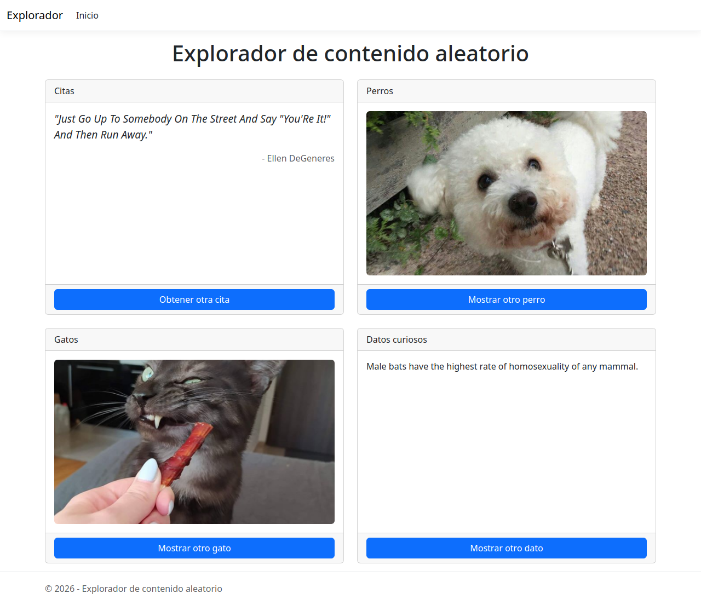
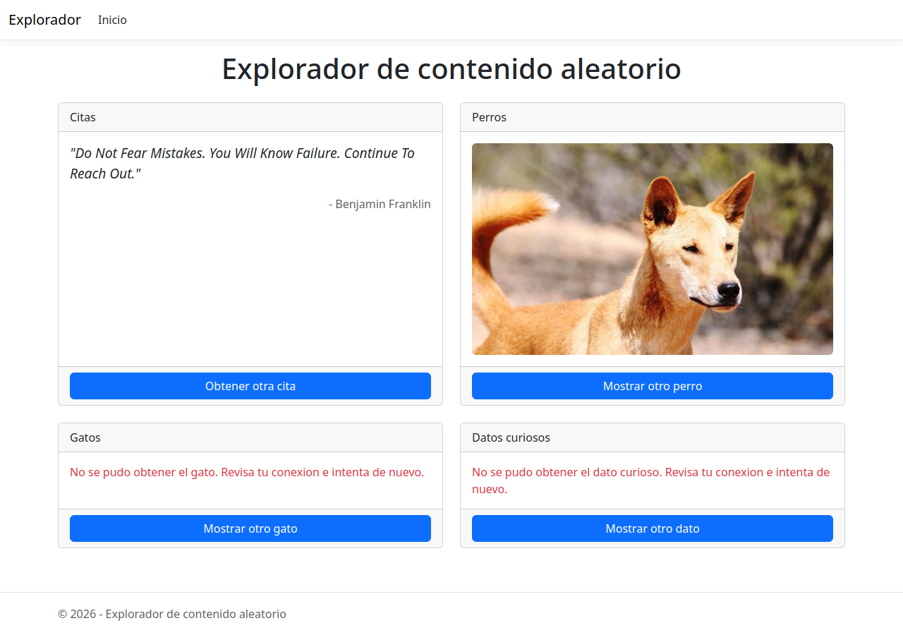

# Explorador de contenido aleatorio

Programación Web III - Tarea: Explorador de contenido aleatorio

Integrante: Julio Cesar Cruz Kübber

Página hecha en ASP.NET Core MVC que muestra cuatro secciones (citas, perros, gatos y datos curiosos). Cada sección consulta su propia API pública con fetch y se actualiza sola con su botón, sin recargar la página.

## Cómo ejecutarlo

Hace falta tener instalado el SDK de .NET 10.

```
cd ExploradorContenido
dotnet run
```

Después abrir en el navegador la dirección que aparece en la consola (por defecto http://localhost:5284). Se necesita conexión a Internet porque el contenido viene de las APIs.

El código de la tarea está en:

- Views/Home/Index.cshtml (las cuatro tarjetas)
- wwwroot/js/explorador.js (las consultas a las APIs)
- wwwroot/css/explorador.css (estilos)

## Capturas

Las cuatro secciones funcionando:



Error controlado (bloqueé las APIs de gatos y datos curiosos, las otras dos siguen funcionando):



## Preguntas de reflexión

**1. ¿Qué es un endpoint y cuál utilizaste para cada API?**

Un endpoint es la URL específica de una API a la que se le hace la petición para obtener un recurso. Usé estos, todos con GET:

- Citas: https://dummyjson.com/quotes/random
- Perros: https://dog.ceo/api/breeds/image/random
- Gatos: https://cataas.com/cat?json=true (y después https://cataas.com/cat/{id} para la imagen)
- Datos curiosos: https://uselessfacts.jsph.pl/api/v2/facts/random?language=en

**2. ¿Qué diferencia existe entre recibir JSON y recibir directamente una imagen?**

El JSON es texto con datos que puedo leer en JavaScript, por ejemplo el id del gato o la url del perro. Una imagen son bytes del archivo, no se puede leer con response.json() porque da error. Por eso en gatos pido primero el JSON con ?json=true, saco el id y con eso armo la url que pongo en el src del img.

**3. ¿Qué función cumplen await y response.json()?**

await hace que la función espere a que termine la promesa (la petición o la lectura) antes de seguir, sin congelar la página. response.json() lee el cuerpo de la respuesta y lo convierte en un objeto de JavaScript, y como también es una promesa se usa con await.

**4. ¿Por qué se debe verificar response.ok además de utilizar try/catch?**

Porque fetch solo entra al catch si falla la red, por ejemplo sin Internet. Si el servidor responde con un error como 404 o 500, fetch lo toma como respuesta normal. Con response.ok reviso que el código sea 200-299 y si no lo es lanzo un error para que lo maneje el catch.

**5. ¿Cómo lograste actualizar una sección sin recargar toda la página?**

Cada sección tiene su propia función async y su botón con addEventListener. Cuando llega la respuesta cambio solo los elementos de esa tarjeta con textContent o el src de la imagen, buscándolos por id. Así las demás secciones no se tocan y la página nunca se recarga.
